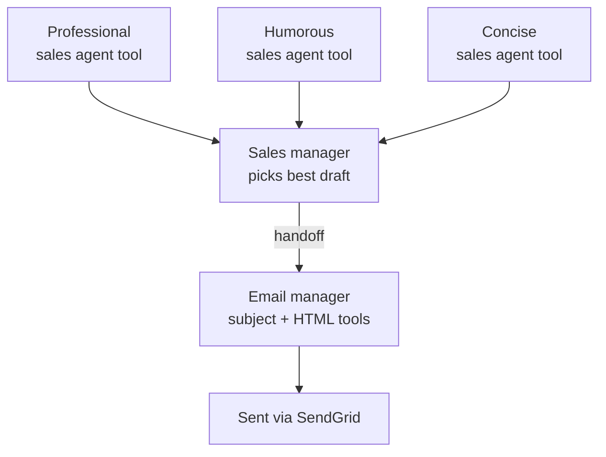
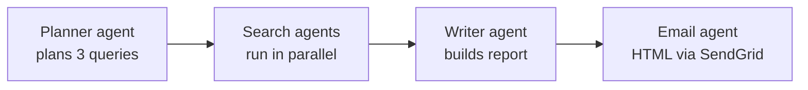
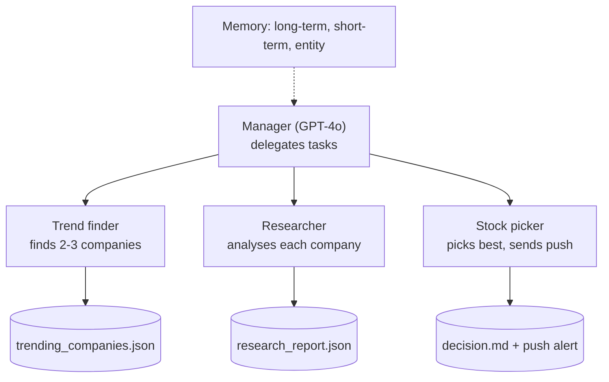
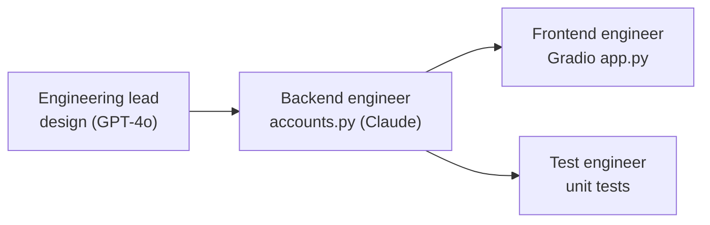
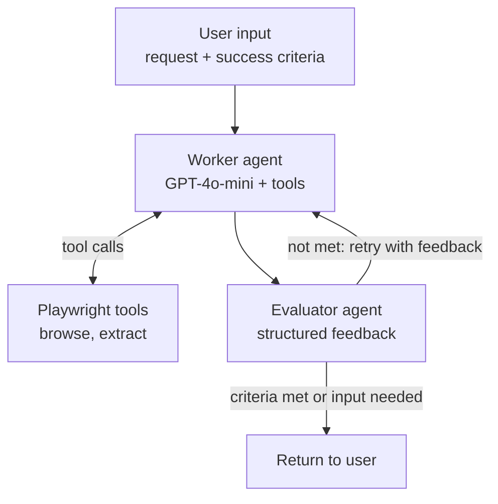

# Agentic AI & Multi-Agent Workflow Development

## Technologies: Python, OpenAI Agents SDK, LangGraph, AutoGen, LangChain, Pydantic, asyncio, SendGrid

* Developed a multi-agent research automation pipeline using the OpenAI Agents SDK, coordinating specialized planning, searching, report-writing, and email agents
* Implemented structured agent outputs using Pydantic models to generate search plans, research summaries, and detailed reports.
* Applied asynchronous programming with Python asyncio to execute multiple research tasks concurrently.
* Integrated web search tools and SendGrid email functionality to automate information retrieval report generation, and distribution.
* Explored multi-agent architectures for software engineering, coding assistance, and financial research using LangGraph and AutoGen

## Project overview

```mermaid
flowchart LR
    subgraph OpenAI["OpenAI"]
        A1["Career twin bot"]
        A2["Sales emails"]
        A3["Deep research"]
    end
    subgraph CrewAI["CrewAI"]
        B1["Stock picker"]
        B2["Coder"]
        B3["Engineering team"]
    end
    subgraph LangGraph["LangGraph"]
        C1["Basic chatbot"]
        C2["Search + memory"]
        C3["Browser agent"]
        C4["Sidekick"]
    end
    subgraph AutoGen["AutoGen"]
        D1["AgentChat + SQL"]
        D2["Multimodal team"]
        D3["Core runtime"]
    end
    OpenAI --> CrewAI --> LangGraph --> AutoGen
```

## Sales email system (OpenAI Agents SDK)

Three sales agents with different styles draft cold emails. The Sales Manager calls them as tools, picks the best draft, and hands off to the Email Manager, which writes a subject line, converts the email to HTML and sends it.

## Deep research (OpenAI Agents SDK)

## Stock picker (CrewAI, hierarchical process)

## Engineering team (CrewAI, sequential process)

## Sidekick (LangGraph)

A worker agent uses Playwright browser tools, and an evaluator agent checks the result against the user's success criteria, looping back with feedback until they are met. A `MemorySaver` checkpointer keeps each conversation thread.

